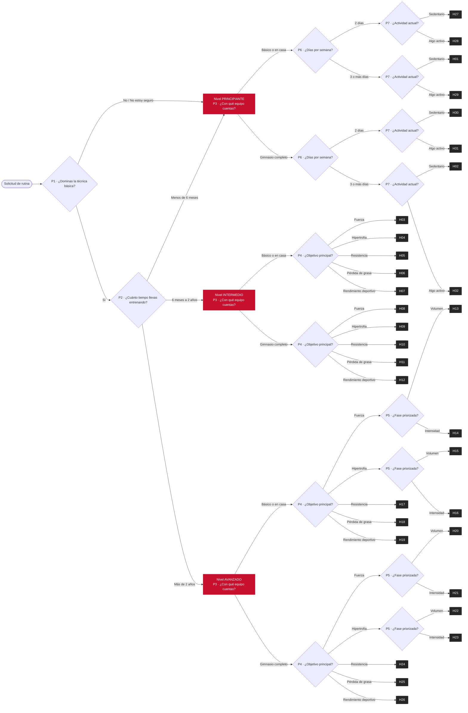

# Árbol de decisión actual · Rutigym (noviembre de 2026)

Reemplaza el árbol de octubre (`arbol_decision.png`). Ese árbol tenía 26 hojas y el nivel Principiante solo se dividía por equipo. Ahora el nivel Principiante se divide además por días por semana (P6) y por actividad actual (P7), y el árbol tiene **32 hojas (H01–H32)** y **48 caminos, que son las reglas R01–R48**.

## Cómo se lee

1. **P1 · Técnica.** Si la respuesta es No o No estoy seguro, el nivel es Principiante. Si es Sí, se pasa a P2.
2. **P2 · Tiempo entrenando.**
   - Menos de 6 meses: Principiante.
   - Entre 6 meses y 2 años: Intermedio.
   - Más de 2 años: Avanzado.
3. **P3 · Equipo** (Básico o en casa, o Gimnasio completo). Se pregunta en los tres niveles.
4. Después, cada nivel sigue su propia rama:
   - **Principiante:** P6, días por semana (2, o 3 o más), y luego P7, actividad (Sedentario o Algo activo). Son 8 hojas: H01, H02 y H27–H32.
   - **Intermedio:** P4, objetivo (Fuerza, Hipertrofia, Resistencia, Pérdida de grasa o Rendimiento deportivo). Son 10 hojas: H03–H12.
   - **Avanzado:** P4, objetivo. Si el objetivo es Fuerza o Hipertrofia, se pregunta además P5, fase (Volumen o Intensidad). Son 14 hojas: H13–H26.

Las reglas son 48 y las hojas 32 porque al nivel Principiante se llega por tres caminos: técnica No, técnica No estoy seguro, o técnica Sí con menos de 6 meses. Esos 3 caminos, por 2 equipos, 2 opciones de días y 2 de actividad, dan 24 reglas. A ellas se suman 10 reglas del nivel Intermedio y 14 del Avanzado.

## Del árbol al motor

El árbol es la referencia del experto. El motor no lo recorre con condicionales: cada camino se convierte en **gránulos** (`hechos_hipotesis`), es decir, hechos que respaldan una hipótesis con un peso. El motor calcula la probabilidad de las 32 hipótesis con esos gránulos y solo hace las preguntas que pueden cambiar la hipótesis líder.

Hay dos controles de que ambos dicen lo mismo:
- `verificar_caminos.py` recorre las 48 reglas y las 720 combinaciones de respuestas, y confirma que siempre gana la hoja del árbol.
- **Automated Reasoning** comprueba cada consulta terminada contra las 48 reglas traducidas a lógica formal.

## Diagrama (Mermaid)

